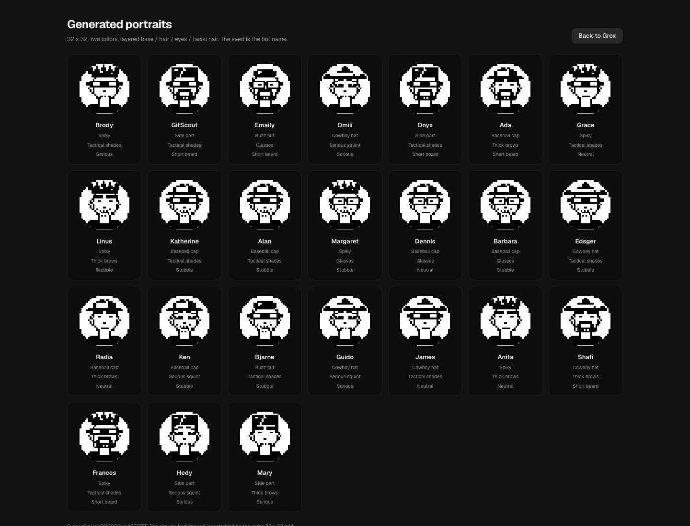

# Generated 1-bit portraits

[简体中文](AVATARS.md)

Grox generates a 32 × 32 black-and-white portrait from each bot or channel name. The same renderer serves the roster, chat header, message sender, call sheet, profile and channel member list.

## Drawing and selection

The generator draws 22 portraits on an integer grid. The faces have broad white areas and compact, neutral features. Sparse highlights separate hair and clothing. Frames retain white space around the pupils. Hair, headwear and collars distinguish characters at contact-list size.

The five starter bots, the starter channel and Grox have fixed designs. For other names, hashing the trimmed, lowercased name selects a portrait and orientation. Different names can share a portrait. A rename can change the selection.

The renderer draws two SVG paths from the grid, one for the white circular background and one for the black portrait. Each path consists of contiguous horizontal pixel runs. Both are clipped to the same raster circle before rendering.

Open `?avatars=1` in the browser preview to see all 22 designs at contact-list size.

- [Portrait generator](../src/lib/pixel-avatar.ts)
- [React renderer](../src/components/PixelAvatar.tsx)
- [Preview gallery](../src/components/AvatarGallery.tsx)
