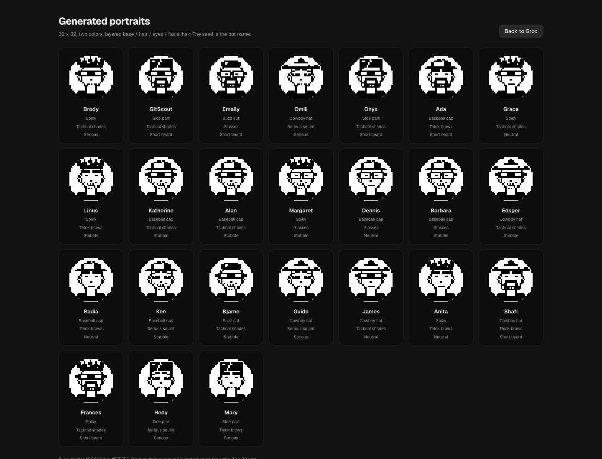

# Generated 1-bit portraits

Grox gives every bot a portrait generated from its name. No avatar image is uploaded or fetched by the
default UI. The same generator is used in the sidebar, chat header, message sender label, call sheet,
profile, channel roster and the group portrait.

## Grid and layers

The canvas is **32 x 32**. A portrait is a stack of independent layers:

1. **base** — shoulders, ears, neck and head, built symmetrically;
2. **hair** — one of five;
3. **eyes** — one of four;
4. **facial hair & mouth** — one of four.

Each layer is an AvatarLayer with two coordinate sets: id, name, black coordinates, and white coordinates.
The sets are applied in stack order. Black and white pixels are both written, so a white fill in a later
layer correctly occludes a black pixel in an earlier layer. The dictionaries are exported from
src/lib/pixel-avatar.ts:

- BASE_LAYER
- HAIR_OPTIONS — buzz cut, side part, spiky, baseball cap, cowboy hat
- EYES_OPTIONS — thick brows, serious squint, black-frame glasses, tactical shades
- FACIAL_OPTIONS — neutral mouth, serious mouth, stubble, short beard

## Determinism

hashSeed(seed) is FNV-1a over the trimmed, lowercased seed. generateAvatar(seed) maps three disjoint parts
of the 32-bit hash to hair, eyes and facial hair:

    hair   = hash % 5
    eyes   = floor(hash / 7) % 4
    facial = floor(hash / 31) % 4

The result is stable across reloads and machines. There are 80 combinations; two names can collide, but a
given name never changes its combination unless the algorithm is changed. generateAvatar is memoized by
the normalized seed. Renaming a bot changes its seed and therefore its portrait.

## Rendering

src/components/PixelAvatar.tsx renders the final grid as SVG:

- only #000000 and #FFFFFF appear inside the SVG;
- a rasterized 32 x 32 circle is used as both a white background and a clipPath;
- shape-rendering="crispEdges" avoids interpolated pixel edges;
- the final black pixels are one-unit rect elements, so scaling is nearest-neighbour;
- a 1px CSS border gives the white circle a defined edge on dark backgrounds.

The circular mask is generated from the same grid (CIRCLE_ROWS, CIRCLE_PATH), not an anti-aliased vector
circle. That keeps the two-colour contract even at the edge.

## Preview

Open ?avatars=1 in the browser preview to see 24 seeds and their layer recipes. The gallery is a debug
surface and is not part of the normal app chrome.

## Files

- src/lib/pixel-avatar.ts — layers, hash, composition, circle mask
- src/components/PixelAvatar.tsx — SVG renderer
- src/components/Mascot.tsx — compatibility wrapper used by the app; ignores old colour/shape/expression
- src/components/AvatarGallery.tsx — ?avatars=1 preview
